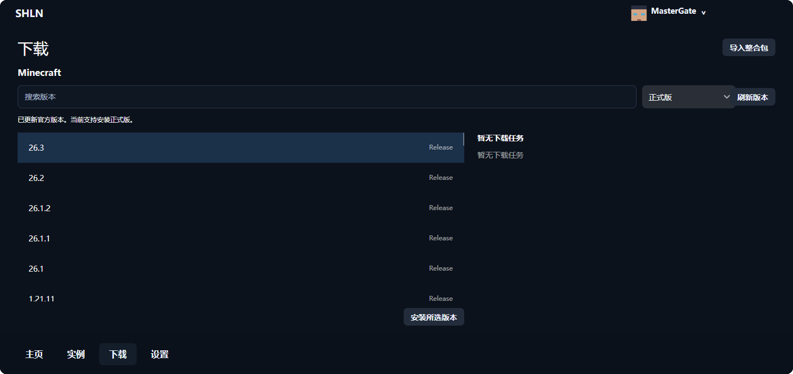
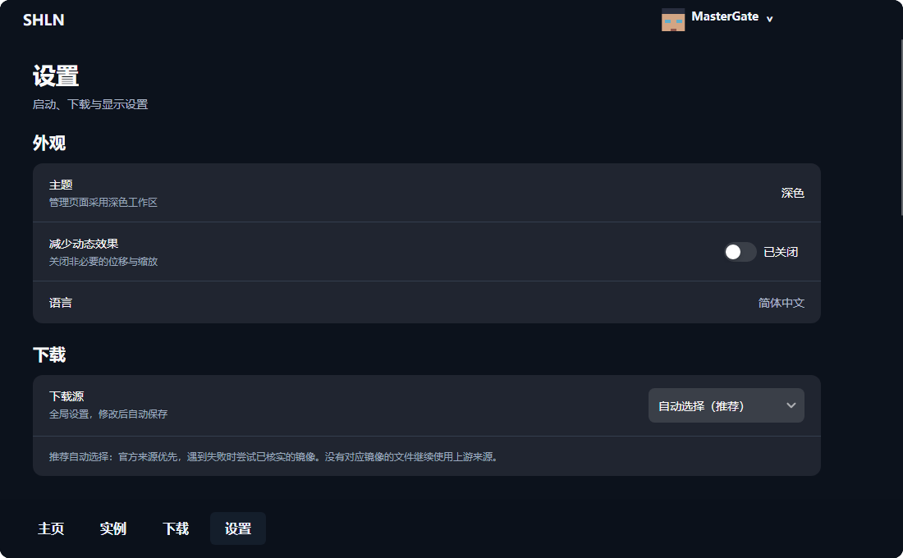

# SHLN · 商寒启动器

**从一片星空，进入你的 Minecraft。**

SHLN 是一款 Minecraft Java 版桌面启动器。首页留给星轨和游戏，安装版本、整理 Mod、调整内存，都在各自的页面里完成。想玩原版，或是给不同的整合配置留一个独立空间，都可以从这里开始。


## 游戏各有各的位置

原版、Fabric、Forge、NeoForge、Quilt，按需选择。每个安装的实例都有自己的 Mod、配置和存档目录，改名字不会搬动游戏文件。下次打开，接着上次选中的实例继续。

下载页面可以搜索 Minecraft 版本，选择加载器，再确认安装。下载进度、失败原因和重试入口集中放在一起，不必翻找日志才能知道发生了什么。



## Mod 多了，也能理清楚

- 按名称、标识或文件名查找本地 Mod，查看版本、作者和依赖信息。
- 多选后批量启用、禁用；移除的文件进入系统回收站。
- 从 Modrinth 或 CurseForge 搜索适合当前实例的内容，选择版本后查看安装计划。
- 在线安装会检查必需依赖、文件大小和哈希。更新保留旧文件备份，中断的替换也有本地恢复入口。

在线内容以平台允许提供的文件为准。CurseForge 需要自己的应用访问配置，设置方法见[使用说明](docs/USAGE.md)。

## 让启动前的准备更省心

游戏内存可以自动分配，也可以手动指定；不同实例能保存不同设置。账号放在右上角，切换角色、查看皮肤与披风不用离开主窗口。离线角色使用统一的默认皮肤。

关掉窗口时，可以选择退出或留在托盘。下载和游戏继续运行，需要时再打开。“清理未使用资源”只释放启动器闲置的缓存与背景资源，不会动你的存档。



## 开始使用

面向 **Windows x64**。从[发布页面](https://github.com/Bantanxiaon/minecraft-java-launcher/releases)下载 SHLN 的 Windows 压缩包，解压到你准备存放启动器和游戏的目录，运行 `SHLauncher.UI.exe`。便携包的数据保存在旁边的 `data` 文件夹，升级时请保留它。

游戏需要对应版本的 Java。可以在设置中指定已有的 Java。启动器不附带 Minecraft 游戏文件，也不提供游戏授权。

目前支持离线账号和兼容 Yggdrasil 的第三方账号服务。Microsoft 账号登录暂未开放；皮肤与披风能否修改，取决于认证服务提供的能力。macOS 与 Linux 暂无发行包。

截图来自当前界面，使用的是示例账号。

## 从源码构建

使用 `global.json` 中指定的 .NET SDK，以及 Python 3.10 或更新版本。

```sh
python tools/dev.py check
python tools/dev.py run
```

`check` 会编译项目并运行检查程序。Windows 便携包可用以下命令构建：

```sh
python tools/publish_windows.py
```

当前主分支为 C# / Avalonia 版本。之前的 Rust / Tauri 版本保留在 Git 历史和旧版发布记录中，不与新版共用程序文件。

## 许可与致谢

项目沿用 [MIT 许可证](LICENSE)。第三方依赖、图标和背景素材的来源与各自许可见 [THIRD-PARTY-NOTICES.md](THIRD-PARTY-NOTICES.md)。背景素材不属于项目的 MIT 授权范围。

本项目不是 Mojang Studios 或 Microsoft 的官方产品。Minecraft 名称及相关资产归各自权利人所有。
